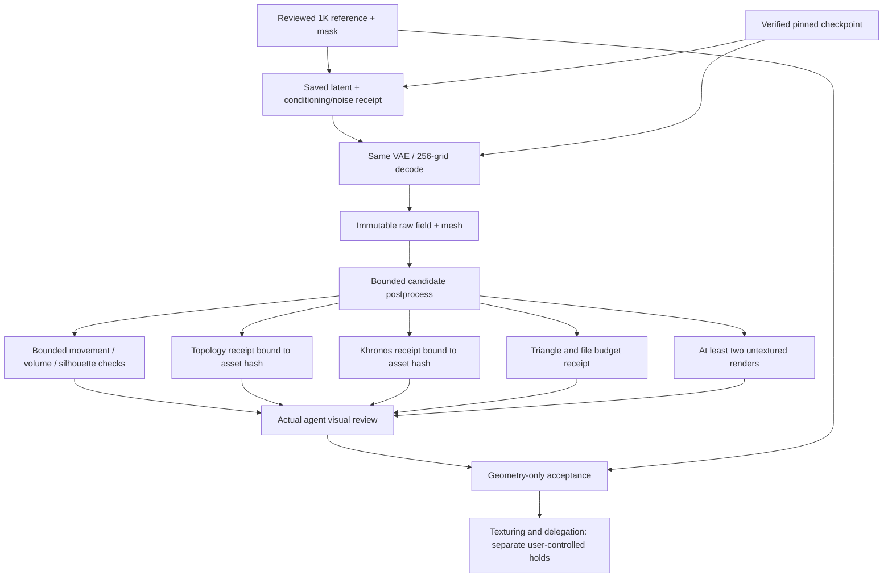

# Local 3D qualification: bounded loops and evidence graph

This adds a qualification gate to the existing local ComfyUI runner. It does not submit jobs, change providers, run background loops, or authorize texturing/delegation. Use the existing `local-comfyui-3d.mjs` for locked/idempotent submissions; a downloaded GLB is still awaiting review.

For an agent dispatch or evidence-only completion, use [LOCAL_3D_AGENT_HANDOFF.md](LOCAL_3D_AGENT_HANDOFF.md). It specifies the receipt map, descriptor generation, case-relative path rules, selected-asset topology/validation, preservation derivations and final sealing checks. It also supplies a fill-in successor prompt; it does not create another runner or grant new-object approval.

## Graph contract



A manifest uses `schema_version: 2` and contains `case_id`, `subject: {object_id, object_class, source: {path, sha256}}`, `asset: {path, sha256}`, `case_binding: {path, sha256}`, `holds`, and `stages`. The binding receipt repeats case ID, object ID/class, source SHA-256 and asset SHA-256; the visual-review receipt must repeat exactly those same identity fields. Source pixels must also be registered as reference-stage evidence. Each stage has `id`, `requires`, `status`, `attempts`, `max_attempts`, and `evidence: [{path, sha256}]`. IDs are those shown by the evaluator's `REQUIRED` constant. All required dependencies must be present; cycles, skipped gates and passed stages with failed parents are rejected. Paths resolve relative to the manifest; absolute paths are supported for checkpoint/source evidence. Every declared evidence hash is rechecked, so edits invalidate acceptance.

Topology, validator, preservation and budget stages additionally supply a `receipt: {path, sha256}`. Receipts bind `asset_sha256` to the selected asset. Topology requires one component and zero boundary/nonmanifold edges; validation requires zero errors/warnings; budget requires <=100k triangles and <=10 MiB. Receipts must come from the actual Blender/validator checks, not hand-estimated counts. The gate verifies receipts/provenance; it does not itself replace those tools or detect adversarially forged review evidence.

A passing visual stage supplies a review receipt with all case/source/object identity fields, `asset_sha256`, `decision: "pass"`, `reviewer`, nonempty `criteria`, and at least two distinct hash-bound `views` already registered by the render stage. The reviewer must inspect those actual images first. Fixture tests do not establish asset quality. State residual defects and the accepted scope; agent acceptance is not independent human acceptance.

Preservation receipts additionally require `max_vertex_to_raw_fraction_diagonal` <0.01, absolute `relative_volume_change` <0.02, and `silhouette_iou` values >=0.98 in all declared views. These compare postprocessing against the raw reconstruction, not against a calibrated photograph.

## Retained reference and new-object rule

The canonical retained case is `reference-cases/diffuse-white-mug-256/`. Its asset, source pixels, two reviewed views, binding receipt, visual review and graph are copied there. `local-3d-reference-cases.json` pins the asset/source identities and exact graph hash. The gate loads this registry automatically. A registered asset cannot inherit another case/object/source identity, and changes to the frozen reference graph invalidate its registry match. This is a project reference registry, not an update to assistant memory.

For another object, create a **new graph before starting the new qualification**, using `local-3d-case-template.json`. It deliberately contains only pending stages and no copied acceptance/evidence. Assign a unique case ID and object ID, review its own source/class, produce its own candidate and case-binding receipt, and inspect its own renders. The evaluator checks complete candidate evidence; an empty planning template is not an accepted/runnable inference workflow. Use the existing runner for submission. The gate prevents acceptance reuse; it does not intercept unrelated GPU submissions.

Current retained graph:

```powershell
python .claude/scripts/asset-pipeline/local-3d-qualification.py --manifest .claude/scripts/asset-pipeline/reference-cases/diffuse-white-mug-256/qualification-graph.json
```

Schema-v1 graphs in older reports remain historical evidence. They are preserved and deliberately rejected by the current gate; use the retained schema-v2 graph above. Do not weaken the gate to accept an old source-unbound record.

The retained core bundle is not a portable copy of the pretrained model or all experimental tensors. Its graph still verifies raw fields/latents/receipts from the original evidence workspace and the checkpoint from the model directory. Preserve those hash-bound paths; moving evidence requires an explicit reviewed migration rather than silently editing a frozen graph. Hash checks and reviewer attribution prevent accidental stale/relabelled acceptance, not adversarial forgery of every artifact by a trusted writer.

## Execute

```powershell
python .claude/scripts/asset-pipeline/local-3d-qualification.py --manifest '<absolute-case-manifest.json>'
python .claude/scripts/asset-pipeline/test_local_3d_qualification.py
```

Exit 0 means `ACCEPTED_GEOMETRY_ONLY`; exit 1 means not accepted; exit 2 means invalid/missing/stale evidence. A valid nonaccepted result lists pending stages whose dependencies have passed and failed stages that exhausted their attempt limit. Never treat `holds` as released by a successful geometry gate.

## Bounded feedback loop

1. Freeze source, checkpoint, noise/conditioning/latent, raw field and raw mesh with hashes. Resume from the first invalidated graph stage, not the beginning.
2. State one hypothesis and change one factor. Give the candidate a new path; preserve rejected candidates and receipts. Set at most three attempts per stage and at most three entries in `loop_history`.
3. Record `{hypothesis, changed_factor, decision}` plus candidate hash and evidence. Accept only after structural, budget, validator and rendered visual checks agree. Numeric improvement alone cannot override a failed render.
4. If the next candidate is not better or reaches the limit, stop that hypothesis and report the remaining defect. Do not manufacture acceptance, vary seeds indefinitely, or conceal defects with texture.
5. Use paired controlled branches for suspected model/decoder differences. Decode saved latents before repeating denoising. Treat latent RMSE, voxel IoU and circularity as diagnostics, not source-accuracy claims.

## Optional smooth-ceramic wall fairing

`local-3d-ceramic-fairing.py` uses Blender's existing QEM and LaplacianSmooth modifier. This is explicit mesh postprocessing, not a correction to model inference. It is restricted to a reviewed upright (Blender Z-up) smooth ceramic vessel reference; do not apply it to croissants, ornament, measured CAD or textured/detail-bearing surfaces.

```powershell
& 'C:/Program Files/Blender Foundation/Blender 5.0/blender.exe' -b --python .claude/scripts/asset-pipeline/local-3d-ceramic-fairing.py -- --input '<immutable-raw.glb>' --output-dir '<new-candidate-folder>' --surface-class smooth-ceramic --iterations 20 60 180
```

The recipe reduces to about 50k triangles, derives a lower-body extent, and tapers vertex weights to protect rim/base/handle. It emits metrics and refuses existing candidate directories. Numeric prerequisites: closed topology/Euler 0, <2% volume change, and maximum candidate-vertex-to-raw distance <1% of mesh diagonal. This one-sided metric is not a Hausdorff or source-accuracy bound. Visual review remains mandatory. Use the least-altered candidate that passes; the iteration counts are a bounded tested range, not a universal default.

## GPU residency and scope

Verify checkpoint/input hashes and inspect existing queues. Preserve the emulator and unrelated applications. On this Windows/WDDM setup inspect physical NVML and CUDA-reported free memory separately. Native `--lowvram --disable-smart-memory --reserve-vram 1` allowed stage offloading where residency caching caused pressure; this is a worker launch configuration, not a fabricated runner flag. Record the actual device/dtype and unload owned workers after completion. If capacity is unavailable, defer GPU work rather than kill unrelated workloads.

Recommended next step for a new case: qualify its reference and material class, prepare a hash-bound manifest, then follow the graph's first ready stage. Generalization requires new-case evidence; one mug does not qualify an image-to-GLB service for all objects.
